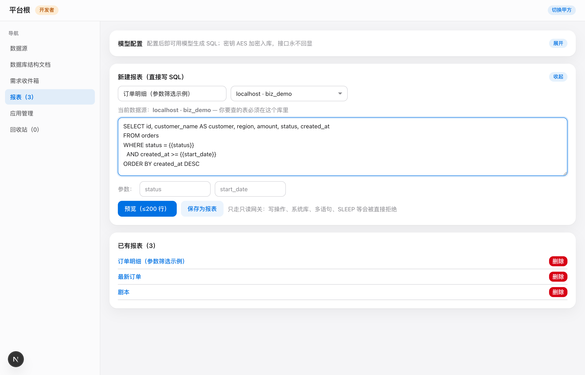
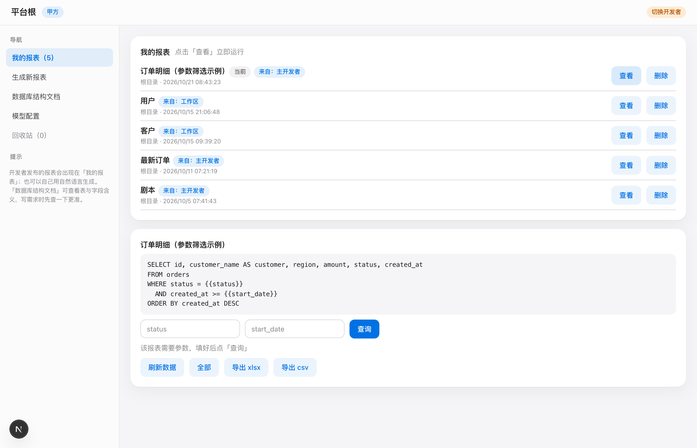
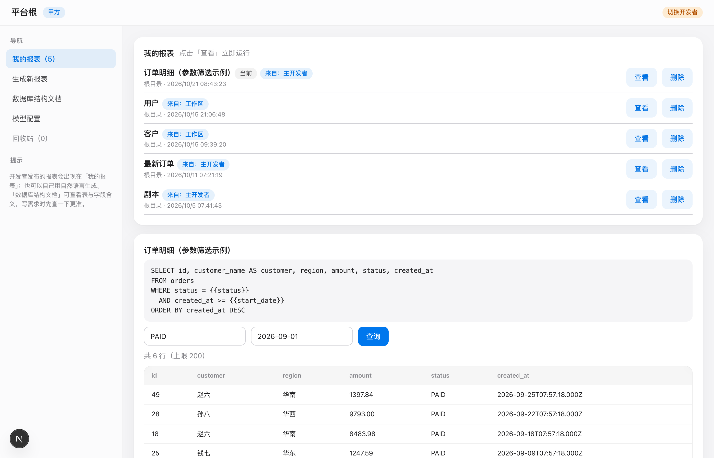
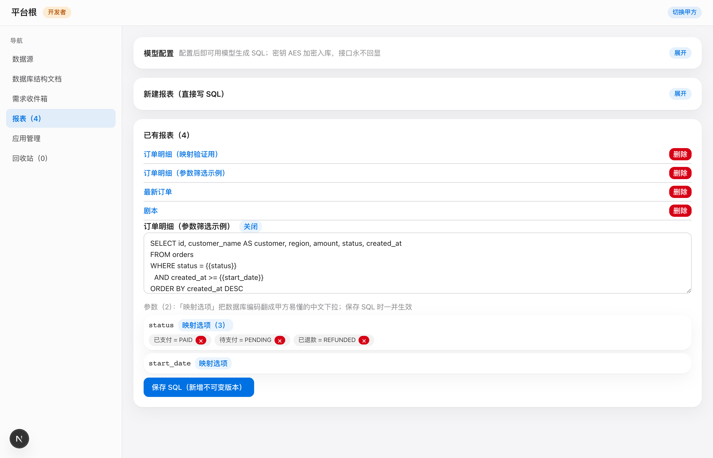
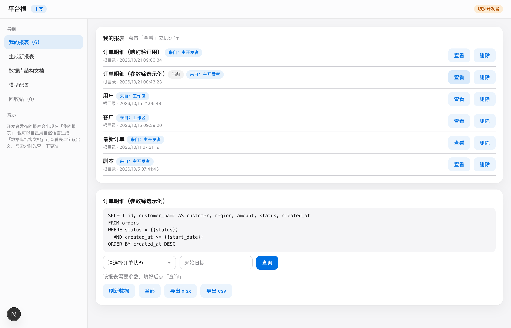
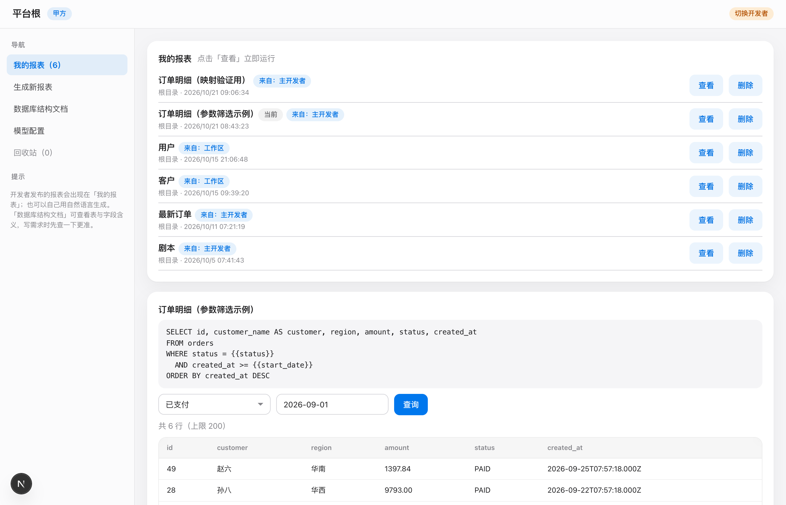

# 企业报表平台 · 帮助文档（v1.0）

> 一句话介绍：把「会用数据库的人」和「要看数据的人」连起来——开发者配置数据源、写 SQL 做成报表；甲方打开链接就能查数、导出，也可以用自然语言让 AI 生成新报表。全程只读、按应用隔离。

- 配套演示视频：`docs/assets/demo-client.webm`（甲方端完整操作）
- 本文档其他格式：`docs/HELP.md`、`docs/help.html`

---

## 1. 三十秒上手

| 你是谁 | 入口 | 能做什么 |
|---|---|---|
| 开发者 | `http://localhost:3111/platform/d` | 配数据源、写/生成 SQL、发布报表、处理甲方需求 |
| 甲方 | `http://localhost:3111/platform/c` | 查报表、翻全量数据、导出 xlsx/csv、自然语言生成新报表 |

> 顶层路径 `/{应用路径}/d`（开发者）与 `/{应用路径}/c`（甲方）。例如 `platform` 应用的甲方入口就是 `/platform/c`。根路径 `/` 会自动跳到平台根的开发者端。

**典型协作流程：**

```
开发者：新建应用 → 配置数据源（只读账号）→ 写 SQL 建报表
                                    ↓
甲方：打开 /c → 点「查看」立即运行 → 需要全量就点「全部」→ 导出
                                    ↓
甲方缺报表？「生成新报表」用自然语言生成；没有配模型时，需求会自动
提交到开发者的「需求收件箱」，由开发者完成并回填报表
```

---

## 2. 开发者端（`/d`）

### 2.1 数据源

- 填 **名称 / 数据库域名 / 端口 / 库名 / 用户名 / 密码** 后点「新建」，域名默认 `localhost`、端口默认 `3306`。
- **请使用只读账号**（仅 SELECT 权限）。平台会做「测试连接」验收：INSERT 必须失败才算合格。
- 同一应用内连接信息完全相同的数据源会被去重（409 提示）。
- 每个数据源支持：**测试 / 设为默认 / 结构文档 / 删除**。
- 删除被报表引用的数据源时不会直接删：选择一个同应用的其他数据源「**改派并删除**」，平台会在同一事务里把报表和运行记录改派过去，避免悬空引用。
- 数据源按应用隔离：A 应用的数据源只能给 A 用，跨应用绑定会被 403 拒绝。

### 2.2 「甲方可见 SQL」开关（数据源页顶部）

| 状态 | 效果 |
|---|---|
| 关闭（默认） | 甲方看不到 SQL，也看不到「数据库结构文档」；甲方端按钮显示「生成报表」 |
| 开启 | 甲方在报表详情可见当前生效的 SQL，可查表/字段含义，便于技术型甲方核对口径 |

> 只对**当前生效版本**生效，历史版本永远不可见。状态徽标只在数据源页显示。

### 2.3 数据库结构文档

自动从数据库读取表、字段、注释、索引并生成文档；展示结果列时优先使用**列注释的第一行**（没有注释则回落到列名）。甲方端的表头含义也来自这里。

### 2.4 报表（写 SQL 建报表）

1. 展开「**新建报表（直接写 SQL）**」，填报表名称、选数据源；
2. 写 SELECT，参数用 `{{名称}}` 占位（仅可出现在**值的位置**），例如：

```sql
SELECT region, COUNT(*) AS cnt, SUM(amount) AS total
FROM orders
WHERE status = {{status}}
GROUP BY region
ORDER BY total DESC
```

3. 「预览（≤200 行）」确认数据无误后「保存为报表」，甲方端立即可见。
4. 点开已有报表可修改 SQL；保存会**新增一个不可变版本**（旧版本保留，可追溯）。

> 带参数的报表完整示例（开发者如何定义、甲方如何填写）见 [第 4 节](#4-参数化报表开发者定义甲方填写)。

> 预览 0 行 ≠ 出错：SQL 已跑通，只是没匹配数据。常见原因：字段存的是编码（如 `status=1`）而不是中文、时间范围不覆盖、选错数据源。

### 2.5 模型配置（内联在「报表」「需求收件箱」里）

- 内置 15 家主流厂商预设，也支持本地模型（OpenAI 兼容协议）；密钥 AES 加密入库，接口永不回显。
- 可设默认、测试连接、启停、删除。
- **开发者与甲方的模型完全独立**：各自配置、各自的 key、各自的默认，互不可见互不干扰。

### 2.6 需求收件箱

甲方没有配模型时点「生成报表」，需求描述会**自动**出现在这里。每条需求可「**据此生成 SQL**」：

1. 补充需求描述 → 选数据源、选模型 → 生成 SQL（生成中可「停止生成」中断后端调用，或「仅取消等待」只停前端等待）；
2. 多个库都能满足时会列出候选，选一个库的 SQL；
3. 预览 →「保存为报表并通知甲方」，该需求自动标记完成并回填报表。

### 2.7 回收站与应用管理

- **回收站**：开发者自己的回收站，与甲方互不干扰；删除的报表可一键「还原」。
- **应用管理**（仅平台根账号可见）：新建应用（名称 + 路径前缀，路径重复会 409）、停用/启用、删除（级联清理应用下全部数据，平台根应用不可删除）。停用后最多 60 秒内全站生效，访问者会看到「该应用已停用」的友好提示而不是空白页。

---

## 3. 甲方端（`/c`）

### 3.1 我的报表

开发者发布的报表 + 你自己保存的报表都在这里，点「**查看**」**立即自动运行**，无需任何额外操作。仅当开发者在 SQL 里定义了参数（`{{名称}}` 占位符）时，才会出现参数输入框，填好后点「查询」（完整示例见 [第 4 节](#4-参数化报表开发者定义甲方填写)）。

- **全部**：想看全量数据时点「全部」，进入分页浏览（每页 20/50/100/200 行可切换），「退出全部」回到预览。
- **导出 xlsx / 导出 csv**：后台异步导出，完成后自动下载；导出期间按钮显示「导出中…」并锁定，不会重复下载。

### 3.2 生成新报表

1. 用自然语言描述需求（例：「最近30天各地区的订单金额汇总，按金额降序」）；
2. 选模型（你自己的模型配置，与开发者无关）→ 点「**生成 SQL**」；
3. 平台读库表结构 → 生成 SQL → 自动校验表名字段；
4. 「预览」确认后「保存为常用报表」，以后在「我的报表」一键运行；
5. 生成不理想可「求助开发者」，需求直达开发者收件箱。

> 没配模型也能用：点「生成报表」会把需求提交给开发者，由开发者完成。

### 3.3 数据库结构文档与模型配置

- 「数据库结构文档」仅在开发者开启「甲方可见 SQL」时显示（写需求前先查一下表与字段含义，需求描述更准）。
- 「模型配置」是你自己的：填自己的 API Key（或本地模型）、设默认、测试连接；生成报表时只用你这里的模型。

### 3.4 回收站

甲方自己的回收站，与开发者互不干扰；删除只影响自己这侧的可见性，可随时「还原」。

---

## 4. 参数化报表：开发者定义，甲方填写

> 结论先行：**无参数报表点开即自动运行；只有开发者在 SQL 里写了 `{{名称}}` 占位符的报表，甲方才需要填参数后点「查询」。**

### 4.1 开发者：用 `{{名称}}` 定义参数

在 SQL 的**值的位置**写占位符即可，无需任何额外配置——保存时平台自动提取参数名、生成参数表单：

```sql
SELECT id, customer_name AS customer, region, amount, status, created_at
FROM orders
WHERE status = {{status}}            -- 参数①：订单状态
  AND created_at >= {{start_date}}   -- 参数②：起始日期
ORDER BY created_at DESC
```

- 占位符格式：`{{参数名}}`（可带空格 `{{ status }}`），参数名用字母/数字/下划线；
- 只允许出现在**值的位置**（`= {{status}}`、`>= {{start_date}}`），写在表名/字段名位置会被网关拒绝；
- 写完后保存前，可在预览区给每个参数填测试值先验证效果（输入框标题即参数名）；
- 保存为报表后，甲方端会自动出现对应输入框。



### 4.2 甲方：填参数查询

1. 打开带参数的报表，会看到提示「**该报表需要参数，填好后点『查询』**」，每个参数一个输入框（标题 = 参数名）；
2. 按提示填值——日期填 `2026-09-01` 这样的格式，状态填库里实际存的值（如 `PAID`，可先在「数据库结构文档」或问开发者）；
3. 点「**查询**」出结果；之后的「全部」「导出」都会按当前参数值执行。

以平台内置示例报表「订单明细（参数筛选示例）」为例：

| 参数 | 含义 | 示例值 |
|---|---|---|
| `status` | 订单状态 | `PAID` |
| `start_date` | 起始日期 | `2026-09-01` |



填好参数点「查询」后的结果：



> 这个示例报表已内置在平台中，可直接打开体验：甲方端「我的报表」→「订单明细（参数筛选示例）」。

### 4.3 进阶：参数映射（把数据库编码翻成中文选项）

数据库里 `status` 存的是 `1/2/3/4` 或 `PAID/PENDING`，甲方看不懂也不会填？开发者可以给参数定义**映射选项**——甲方只看到中文下拉，提交时服务端自动换成数据库值：

- **开发者定义**：写 SQL 后，参数区点「**映射选项**」，逐条添加「显示名 → 数据库值」：
  - 显示名 `好` → 数据库值 `1`
  - 显示名 `还行` → 数据库值 `2`
  - 显示名 `普通` → 数据库值 `3`
  - 显示名 `不好` → 数据库值 `4`
- **甲方填写**：该参数自动变成**下拉框**，只显示「好 / 还行 / 普通 / 不好」；选「好」点查询，实际送到数据库的是 `1`。
- **防篡改**：映射在**服务端**完成——甲方直接提交编码（如 `1`）会被 400 拒绝，必须从下拉选；下拉项外的值同样拒绝。
- 已保存的报表随时可以到「已有报表 → 点开 → 映射选项」增删选项，保存 SQL 时一并生效。

以平台内置示例报表「订单明细（参数筛选示例）」为例（`status` 字段存的是英文编码）：

| 数据库值 | 甲方看到的选项 |
|---|---|
| `PAID` | 已支付 |
| `PENDING` | 待支付 |
| `REFUNDED` | 已退款 |





选「已支付」+ 起始日期 `2026-09-01` 查询的结果：



---

## 5. 身份与多设备

- **无需注册登录**：每个浏览器第一次访问时自动获得一个私密身份（Cookie），开发者的配置按身份隔离，谁也看不到谁的。
- **换设备 / 分享身份**：在地址后加 `?ws=<身份串>` 即可把身份带到新设备。查自己的身份串：打开 `/{应用}/d/api/bootstrap`，返回里的 `workspace.wsKey` 就是。
- 甲方端是「汇总视图」：所有开发者工作区发布的报表都会出现在 `/c`。

---

## 6. 安全边界（SQL 只读网关）

所有 SQL（无论人写还是 AI 生成）都经过同一道只读网关，五道闸依次校验：

1. **只读白名单**：仅允许 `SELECT` / `WITH...SELECT`，按 AST 根类型判断，注释伪装无效；
2. **危险函数黑名单**：`SLEEP`、`BENCHMARK`、`LOAD_FILE`、`INTO OUTFILE` 等直接拒绝；
3. **库范围**：`mysql` / `sys` / `performance_schema` / `information_schema` 等系统库禁止访问，跨库访问不允许的库也会被拒；
4. **深度扫描**：剥离注释与字符串后再扫一遍关键字，可执行注释 `/*!` 直接拒绝；
5. **硬截断**：执行会话强制只读、默认超时 15 秒、默认单次最多返回 200 行（「全部」模式也走分页截断）。

参数 `{{name}}` 只允许出现在值的位置，防注入；写操作、多语句一律拒绝。

---

## 7. 本地运行（开发者参考）

```bash
# 1. 准备数据库（MySQL root/root，平台库 report_platform，演示业务库 biz_demo）
mysql -uroot -proot < scripts/setup-infra.sql

# 2. 启动（端口 3111）
node node_modules/next/dist/bin/next dev -p 3111

# 3. 质量检查
npx tsc --noEmit          # 类型检查
npm run test:gateway      # SQL 网关对抗测试（20 例）
```

环境变量见 `.env.local`（平台库连接、导出目录、网关默认参数等）。

---

## 8. 常见问题

**Q：甲方点「查看」没数据？**
先确认报表绑定的数据源还能连通（开发者端「测试」），再确认参数取值在库里存在。

**Q：预览报「语句类型不被允许 / 命中规则 XXX」？**
网关只放行只读 SELECT。去掉写操作、系统库、SLEEP 等即可；`/*!` 开头的注释也是被禁的。

**Q：甲方看不到「数据库结构文档」？**
开发者在「数据源」页把「甲方可见 SQL」开关打开。

**Q：导出文件在哪里？**
点击导出后页面会持续轮询任务，完成后浏览器自动下载，无需手动找文件；导出历史保留 24 小时。

**Q：生成的 SQL 不对/跑不通？**
甲方可在预览结果下方「求助开发者」；需求会进入开发者收件箱，由开发者生成并回填报表。

**Q：删错了报表/应用？**
报表在回收站里可还原；应用删除是级联且不可恢复的，请谨慎操作。
