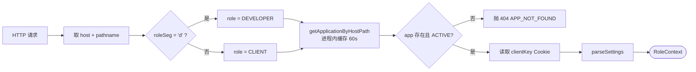
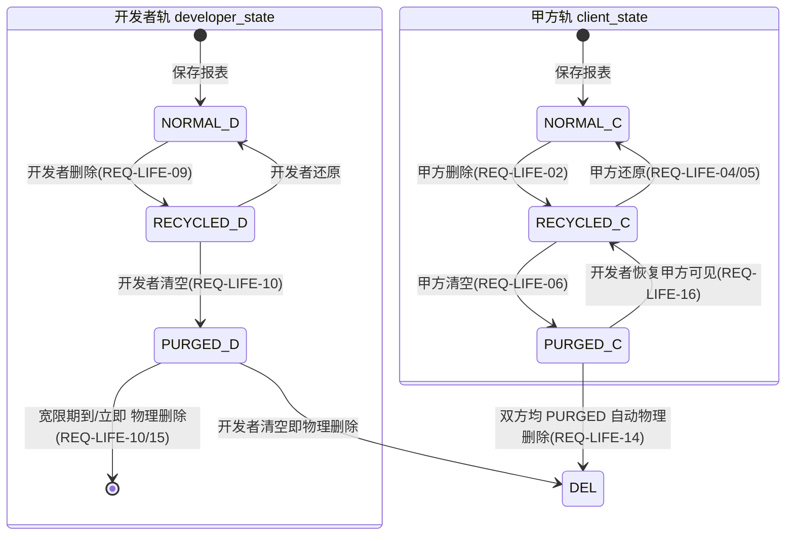
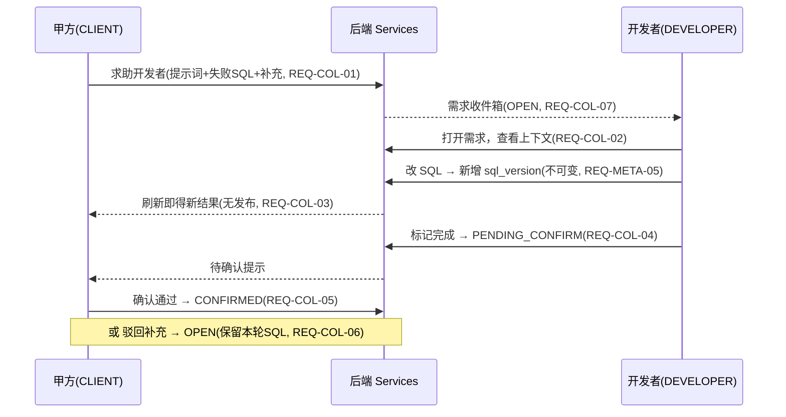

# 企业报表平台 · 设计方案与技术文档

> **读者**：作者本人独立实现
> **栈**：Next.js 15（App Router）+ TypeScript + MySQL 8，单机部署
> **前置输入**：`spec/00-prompt.md`、`spec/01-requirements.md`（EARS 113 条）、`spec/02-design.md`、`spec/03-decisions.md`
> **本文定位**：只写「照着能写出来」的东西。需求背景、EARS 需求条目、决策依据一律不重复，需要时回查上述四份文档。
> **本文版本**：在 v1 基础上打磨——（1）全文以「对应 REQ-XXX」标注需求落点，对齐 `01-requirements.md` 并补全少量缺口；（2）补目录导航与 Mermaid 图（架构 / 双轨状态机 / 请求链路 / 参数执行 / 协作时序）；（3）统一术语与编号。

---

## 目录

- [0. 已确认前提（一页速览）](#0-已确认前提一页速览)
- [1. 技术选型](#1-技术选型)
- [2. 总体架构与请求链路](#2-总体架构与请求链路)
- [3. 目录结构](#3-目录结构)
- [4. 数据模型](#4-数据模型)
- [5. 接口契约](#5-接口契约)
- [6. 关键实现 A：SQL 安全网关](#6-关键实现-aSQL-安全网关)
- [7. 关键实现 B：双轨生命周期服务](#7-关键实现-b双轨生命周期服务)
- [8. 关键实现 C：导出](#8-关键实现-c导出)
- [9. 关键实现 D：API Route 示例](#9-关键实现-dapi-route-示例)
- [10. 前端交互与组件结构](#10-前端交互与组件结构)
- [11. 里程碑](#11-里程碑)
- [12. SQL 安全网关：绕过手法与对抗用例](#12-sql-安全网关绕过手法与对抗用例)
- [13. 双轨生命周期边界情况清单](#13-双轨生命周期边界情况清单)
- [14. 上线检查清单与故障排查](#14-上线检查清单与故障排查)
- [15. 实测校正记录](#15-实测校正记录)
- [16. 遗留问题](#16-遗留问题)
- [17. 缺口补全（对齐 spec 的少量新增）](#17-缺口补全对齐-spec-的少量新增)
- [18. 附录：本文与 4 份 spec 的章节映射](#18-附录本文与-4-份-spec-的章节映射)

---

## 0. 已确认前提（一页速览）

| 维度 | 结论 | 对应需求 |
|---|---|---|
| 目标 | 企业内部免登录报表平台；提示词生成 SQL → 预览 → 导出（80%）或保存为常用报表（20%） | P-01~P-05 |
| 角色 | 仅两个：`CLIENT`（甲方）/ `DEVELOPER`（开发者）。无登录，角色由入口目录推导 | REQ-ACC-01/02/04/05 |
| 隔离 | 应用 = 域名 + 目录前缀；每应用独立的数据源、报表、标签树 | REQ-ACC-03、P-13 |
| 技术栈 | Next.js 15 App Router + TypeScript（Node runtime），单进程 | — |
| 基础设施 | **只有 MySQL**。异步任务用表轮询，限流/缓存用进程内内存，导出文件存本地磁盘 | A-05 |
| NL2SQL | OpenAI 兼容 SDK，`baseURL` 可配，默认指向私有化端点；**仅出网元数据 + 提示词** | REQ-GEN-05/08/10、A-08 |
| 集成 | 一期独立 Web 应用，iframe 嵌入与同域反代**已预留 `embedMode`**，并补无边框 + postMessage 高度自适应 | REQ-ACC-09、Q-10 |
| 范围 | 覆盖 S1~S8，按 M0~M6 里程碑推进 | — |
| 治理 | 内置**平台根应用**（`is_platform_root`）承载应用创建/停用，不引入第三角色 | REQ-ACC-10/11/12/13、Q-08 |
| 核心模型 | 双轨生命周期（client_state / developer_state）+ 双标签树（每角色一棵） | REQ-LIFE-01、REQ-TAG-01 |

---

## 1. 技术选型

| 领域 | 选择 | 理由 | 被否掉的备选 |
|---|---|---|---|
| 运行时 | **Node.js 22 LTS** | 与 Next.js 15 兼容；`node:crypto`、`stream` 原生够用 | Node 18（即将 EOL） |
| 框架 | **Next.js 15 App Router** | 前后端同仓库同构建，一次部署；Route Handler 写 API 直接 | NestJS（多一层工程规范，单人开发收益低） |
| 数据库驱动 | **mysql2**（promise + stream） | 支持 prepared statement（`execute`）、流式读取（导出必须）、`multipleStatements` 可显式关闭 | Prisma（ORM 不适合动态 SQL 场景，反而碍事） |
| SQL 解析 | **node-sql-parser** | 能把 SQL 解析成 AST，白名单校验才有意义；支持 MySQL 方言 | 正则黑名单（可被注释/大小写/可执行注释绕过，见 §12） |
| Excel 导出 | **exceljs**（streaming writer） | 5 万行必须流式写，否则内存打爆 | `xlsx` 库（全量驻留内存） |
| CSV 导出 | 自写 | 只需处理转义与 **CSV 公式注入防护**（见 §8.2） | — |
| 参数校验 | **zod** | 参数表单、配置、接口入参统一 | 手写 if（边界太多） |
| LLM | **openai** SDK，`baseURL` 可配 | 一套代码适配 vLLM / Ollama / DeepSeek / 通义兼容端点 | 各家官方 SDK（锁定厂商） |
| 凭据加密 | `node:crypto` **AES-256-GCM** | 内置、无需额外依赖；密钥放环境变量 | 引入 KMS（单机部署过重） |
| ID | `crypto.randomUUID()` | 原生 | nanoid（多一个依赖） |
| 缓存 / 限流 | 进程内 `Map` + TTL | 单机部署够用；接口做成可替换，将来换 Redis | Redis（要多运维一个组件） |
| 拖拽 | **@dnd-kit/core** | 标签树拖拽需要；体积小、无障碍好 | react-dnd（API 重） |
| 样式 | **Tailwind CSS** | 单人开发效率最高 | CSS Modules（写起来慢） |

### 1.1 一条硬性纪律

> **SQL 网关只有一个入口**：`execute(sqlTemplate, params)`。
> 全项目禁止出现第二处执行业务 SQL 的代码。无参数时 `params` 传空数组，依然走 prepared statement。
> 这条是 ADR-13 的落地，也是整个安全模型的单点（对应 REQ-SEC-08、REQ-PARAM-07）。

---

## 2. 总体架构与请求链路

### 2.1 进程结构（单机单进程）

```mermaid
flowchart TB
  subgraph Edge["L0 接入层 · middleware.ts (Edge runtime)"]
    A0[host + path 解析 Application]
    A1[下发/读取 clientKey Cookie<br/>HttpOnly, SameSite=Lax]
    A2[rewrite /{appPath}/{c|d}/* → /tenant/...]
  end
  subgraph Node["L1 应用服务层 · Server Components / Route Handlers (Node runtime)"]
    B0[resolveContext → RoleContext<br/>{appId, role, clientKey, settings}]
    B1[Services: Application / DataSource / Catalog<br/>Report / TagTree / Lifecycle / Requirement<br/>Export / Generation / Audit]
  end
  subgraph GW["L2 SQL 网关 SqlGateway.execute(template, params)"]
    C0[Parse → Validate → Rewrite → Execute → Shape]
  end
  subgraph Store["L3 元数据存储 Platform DB"]
    D0[(application / data_source / report<br/>tag_node / report_placement<br/>requirement / sql_version<br/>run_record / audit_log / export_task)]
  end
  subgraph DS["L4 数据源适配层 DataSourceAdapter"]
    E0[(业务只读库, 按 dsId 隔离)]
  end
  Edge --> Node --> GW
  GW --> Store
  GW --> DS
```

> 说明：L0 只做 rewrite + Cookie，**不查数据库**（Edge runtime 无 TCP socket，见 §2.2 坑 2）。L1 每次请求重算 `RoleContext`，绝不信任前端传入角色（对应 REQ-ACC-04/05/06、DP-2）。平台元库与业务库**物理隔离**，账号不复用（对应 REQ-SEC-05、ADR-09）。

### 2.2 四个必须提前知道的 Next.js 坑

这四条如果到写的时候才发现，会返工。

| # | 坑 | 表现 | 解法 |
|---|---|---|---|
| 1 | **`basePath` 是构建期常量** | 想要「不同应用用不同目录前缀」，但 `next.config.js` 的 `basePath` 编译时就固定了，运行时改不了 | 不用 `basePath`。改在 `middleware.ts` 里做 **rewrite**：`/{appPath}/c/*` → `/tenant/[appPath]/c/*`，把目录前缀当动态段处理。⚠ **rewrite 目标不能以 `_` 开头** —— `_app` 这类下划线目录是 Next.js 私有目录，会被直接排除出路由（实测改用 `/tenant/...`，见 §15.2） |
| 2 | **middleware 跑在 Edge runtime** | 在 middleware 里 `import mysql2` 直接报错（无 TCP socket） | middleware 只做三件事：rewrite、cookie、路径合法性判断。**查 `application` 表必须放到 Node runtime**（Route Handler / Server Component 里做，并加进程内缓存） |
| 3 | **Route Handler 可能被静态化** | 接口返回了构建时的数据 | 所有 API Route 显式声明 `export const dynamic = 'force-dynamic'` 且 `export const runtime = 'nodejs'` |
| 4 | **Server Action / RSC 里的敏感判断** | 在客户端组件里判断 `role` 决定是否渲染 SQL | 角色判断和鉴权**只在服务端**。前端不渲染只是体验，不是安全边界（REQ-META-04 要求在接口层 403） |

### 2.3 RoleContext 解析（必须每次重算）



```ts
// src/server/context.ts
export type Role = 'CLIENT' | 'DEVELOPER';
export interface RoleContext {
  appId: string;
  role: Role;
  clientKey: string;
  settings: AppSettings;
}

// 每次请求都重新解析，绝不信任前端传入的 role（对应 REQ-ACC-03/04/05、DP-2）
export async function resolveContext(req: Request): Promise<RoleContext> {
  const url = new URL(req.url);
  const host = req.headers.get('host') ?? '';
  const seg = url.pathname.split('/').filter(Boolean); // [appPath, 'c'|'d', ...]

  const appPath = seg[0] ?? '';
  const roleSeg = seg[1] ?? '';
  if (roleSeg !== 'c' && roleSeg !== 'd') throw new HttpError(404, 'APP_NOT_FOUND');

  const app = await getApplicationByHostPath(host, appPath); // 带进程内缓存
  if (!app || app.status !== 'ACTIVE') throw new HttpError(404, 'APP_NOT_FOUND'); // REQ-ACC-07：停用应用统一占位，不泄露报表名/库表

  return {
    appId: app.id,
    role: roleSeg === 'd' ? 'DEVELOPER' : 'CLIENT',
    clientKey: readClientKey(req),   // 由 middleware 写入的 Cookie（对应 REQ-ACC-08）
    settings: parseSettings(app.settings_json),
  };
}
```

> `getApplicationByHostPath` 用进程内 Map 缓存 60 秒，避免每个请求都打库。**应用停用后最多 60 秒生效**，可接受；若需立即生效，提供缓存清除接口（REQ-ACC-07）。
> 角色判定服务端重算后，CLIENT 的接口层直接拒绝数据源/SQL 编辑端点（REQ-ACC-06），前端不渲染仅作体验。

---

## 3. 目录结构

```
report-platform/
├─ schema.sql                       # 平台元库建表（见同目录 schema.sql）
├─ next.config.js
├─ .env.local                       # APP_ENC_KEY / PLATFORM_DB_URL / EXPORT_DIR ...
├─ data/
│  └─ exports/                      # 导出文件本地目录（TTL 清理）
└─ src/
   ├─ middleware.ts                 # Edge：rewrite + clientKey cookie
   ├─ app/
   │  ├─ tenant/
   │  │  └─ [appPath]/
   │  │     ├─ c/                   # 甲方页面（rewrite 目标）
   │  │     │  ├─ page.tsx          # 报表列表 + 标签树
   │  │     │  └─ reports/[id]/page.tsx
   │  │     └─ d/                   # 开发者页面
   │  │        ├─ page.tsx
   │  │        ├─ data-sources/
   │  │        ├─ applications/     # 仅平台根应用可见
   │  │        └─ requirements/
   │  └─ api/
   │     ├─ applications/route.ts
   │     ├─ data-sources/route.ts
   │     ├─ reports/route.ts
   │     ├─ reports/[id]/route.ts
   │     ├─ reports/[id]/sql/route.ts
   │     ├─ reports/generate/route.ts
   │     ├─ reports/preview/route.ts
   │     ├─ exports/route.ts
   │     ├─ exports/[id]/route.ts
   │     ├─ tag-tree/route.ts
   │     ├─ recycle-bin/route.ts
   │     └─ requirements/route.ts
   ├─ server/
   │  ├─ context.ts                 # RoleContext
   │  ├─ errors.ts                  # 统一错误结构
   │  ├─ crypto.ts                  # AES-256-GCM 加解密
   │  ├─ cache.ts                   # 进程内 TTL 缓存
   │  ├─ ratelimit.ts               # 进程内令牌桶
   │  ├─ db/
   │  │  ├─ platform.ts             # 平台元库连接池
   │  │  └─ datasource.ts           # 业务库连接池（按 dsId 隔离）+ DataSourceAdapter 适配点
   │  ├─ sql/
   │  │  ├─ parser.ts               # AST 解析 + 占位符抽取
   │  │  ├─ validator.ts            # 白名单 / 黑名单 / 库范围
   │  │  ├─ rewriter.ts             # LIMIT 与超时注入
   │  │  ├─ executor.ts             # 只读会话 + prepared statement
   │  │  └─ gateway.ts              # ★ 唯一入口 execute()
   │  ├─ services/
   │  │  ├─ application.ts          # 含平台根应用初始化（REQ-ACC-10/11/13）
   │  │  ├─ datasource.ts
   │  │  ├─ catalog.ts              # 元数据抓取与缓存
   │  │  ├─ report.ts
   │  │  ├─ tagTree.ts
   │  │  ├─ lifecycle.ts            # ★ 双轨生命周期
   │  │  ├─ requirement.ts
   │  │  ├─ export.ts
   │  │  ├─ generation.ts           # NL2SQL（仅出网元数据+提示词，REQ-GEN-05/10）
   │  │  └─ audit.ts
   │  └─ jobs/
   │     ├─ exportWorker.ts
   │     ├─ purgeWorker.ts
   │     └─ ttlWorker.ts
   ├─ components/
   │  ├─ TagTree/                   # 标签树 + 拖拽
   │  ├─ ReportList/
   │  ├─ ParamForm/                 # 参数表单（按 schema 渲染）
   │  ├─ ResultTable/               # 预览表格
   │  ├─ SqlEditor/                 # 仅开发者
   │  ├─ RecycleBin/
   │  └─ RequirementPanel/
   └─ lib/
      ├─ api.ts                     # 前端 fetch 封装
      └─ types.ts
```

> 应用管理（`POST /applications`、`POST /applications/{id}:disable`）仅平台根应用的 DEVELOPER 可见可用（对应 REQ-ACC-10/11/12/13、ADR-14）。数据源层 `DataSourceAdapter` 预留多源适配点（对应 REQ-DS-07）。

---

## 4. 数据模型

完整建表语句见同目录 **`schema.sql`**（可直接 `mysql < schema.sql` 执行）。这里只列**容易写错**的约束。

### 4.1 关键约束清单

| 约束 | 为什么必须有 | 对应需求 |
|---|---|---|
| `application` 唯一索引 `(host, path_prefix)` | 路由解析歧义直接导致串应用 | REQ-ACC-03、REQ-ACC-12 |
| `application` 全局唯一 `is_platform_root` | 平台根应用是治理入口，只能有一个 | REQ-ACC-10/13 |
| `tag_node` 每 `(app_id, role)` 有且仅有一个 `ROOT` 和一个 `RECYCLE_BIN` | 用**部分唯一索引**模拟（见 §4.2） | REQ-TAG-01/03 |
| `report_placement` 唯一索引 `(report_id, role)` | 防止一份报表在同一棵树出现两次 | REQ-TAG-05、DP-02 |
| `report` 双状态字段 `client_state` + `developer_state` | 双轨生命周期的地基 | REQ-LIFE-01、ADR-01 |
| `report` 索引 `(app_id, client_state)`、`(app_id, developer_state)` | 列表与回收站查询走索引 | REQ-LIFE-03/12 |
| `export_task` 索引 `(app_id, client_key, started_at)` | 「我的导出历史」查询 | REQ-EXP-08、Q-09 |
| `audit_log` 按 `started_at` 月度分区 | 180 天留存，按月 drop 分区 | REQ-SEC-12、REQ-NFR-05 |

### 4.2 关于「系统节点唯一性」的落地写法

```sql
-- kind_uniq 用于系统节点（ROOT / RECYCLE_BIN），普通目录此项为 NULL
-- MySQL 唯一索引允许重复的 NULL，因此普通目录不受约束
ALTER TABLE tag_node
  ADD COLUMN kind_uniq ENUM('ROOT','RECYCLE_BIN') NULL,
  ADD UNIQUE KEY uk_system_node (app_id, role, kind_uniq);
```

> 这是 MySQL 下模拟「部分唯一索引」的标准做法，比在应用层加锁可靠（对应 REQ-TAG-03）。

### 4.3 状态与枚举

```
client_state / developer_state : NORMAL | RECYCLED | PURGED
tag_node.kind                  : ROOT | NORMAL | RECYCLE_BIN
requirement.status             : OPEN | IN_PROGRESS | PENDING_CONFIRM | CONFIRMED | REJECTED
export_task.status             : RUNNING | DONE | FAILED | EXPIRED
run_record.source              : PREVIEW | EXPORT | SAVE | DEV_DEBUG
run_record.result              : SUCCESS | FAILED | REJECTED
```

> `sql_version` 追加不可变（REQ-META-05），`requirement` 多轮留痕（REQ-META-01/02/03），均随报表物理删除级联清理（§7 `hardDelete`）。

---

## 5. 接口契约

统一前缀：`/{host}/{appPath}/{c|d}/api`。所有接口由服务端重算 `RoleContext`。

| 方法 | 路径 | 角色 | 说明 | 对应需求 |
|---|---|---|---|---|
| GET | `/bootstrap` | 两者 | 应用信息 + 角色 + 标签树（首屏一次拿全） | REQ-ACC-03/04 |
| POST | `/applications` | DEV（仅根应用） | 创建应用并初始化两棵树 | REQ-ACC-10/11 |
| POST | `/applications/{id}:disable` | DEV（仅根应用） | 停用应用（根应用拒绝，REQ-ACC-13） | REQ-ACC-07/13 |
| GET/POST | `/data-sources` | DEV | 列表（**不含凭据**）/ 新建 | REQ-DS-01/03 |
| POST | `/data-sources/{id}/test` | DEV | 测试连接 + 只读校验 | REQ-DS-02/05 |
| POST | `/data-sources/{id}/catalog:refresh` | DEV | 刷新元数据 | REQ-DS-04 |
| POST | `/reports/generate` | 两者 | 提示词 → 候选 SQL（不执行） | REQ-GEN-01/02 |
| POST | `/reports/preview` | 两者 | 预览（≤200 行，走 SQL 网关） | REQ-GEN-03/04 |
| POST | `/exports` | 两者 | 发起导出 | REQ-EXP-01/02 |
| GET | `/exports/{id}` | 两者 | 任务状态 / 下载 | REQ-EXP-04 |
| GET | `/exports/mine` | 两者 | 我的导出历史（30 天） | REQ-EXP-08、Q-09 |
| POST | `/exports/{id}:rerun` | 两者 | 过期重跑 | REQ-EXP-09 |
| POST | `/reports` | 两者 | 保存为常用报表 | REQ-SAVE-01/02/06 |
| GET | `/reports` | 两者 | 列表（按本角色轨过滤） | REQ-LIFE-07/12 |
| GET | `/reports/{id}` | 两者 | 详情；`currentSql` 按 `clientCanViewSql` 决定 | REQ-META-04/07 |
| PUT | `/reports/{id}/sql` | DEV | 改 SQL（新增不可变版本） | REQ-COL-03、REQ-META-05 |
| GET | `/reports/{id}/params` | 两者 | 参数定义（渲染表单） | REQ-PARAM-02/04 |
| GET | `/reports/{id}/sql-versions` | DEV | SQL 版本历史 | REQ-META-03/06 |
| GET | `/reports/{id}/requirements` | 两者 | 甲方只见自己的；开发者见全部 | REQ-META-02/03 |
| GET/POST | `/tag-tree` / `/tag-tree/nodes` | 两者 | 本角色标签树 CRUD | REQ-TAG-04 |
| POST | `/reports/{id}:move` | 两者 | 移动（仅影响本角色树） | REQ-TAG-05 |
| POST | `/reports/{id}:delete` | 两者 | 移入本角色回收站 | REQ-LIFE-02/09 |
| POST | `/reports/{id}:restore` | 两者 | 还原（原父失效落根） | REQ-LIFE-04/05 |
| POST | `/recycle-bin:purge` | 两者 | 清空（甲方=不可见 / 开发者=物理删除） | REQ-LIFE-06/10/11 |
| POST | `/reports/{id}:restore-client-visibility` | DEV | 甲方 PURGED → RECYCLED | REQ-LIFE-16、Q-05 |
| GET | `/requirements/inbox` | DEV | 需求收件箱 | REQ-COL-07 |
| POST | `/requirements/{id}:complete` | DEV | 标记完成 | REQ-COL-04 |
| POST | `/requirements/{id}:confirm` | CLIENT | 确认 / 驳回 | REQ-COL-05/06 |

**统一错误结构**：`{ code, message, traceId }`。`message` 可展示给用户，但**不得包含堆栈、SQL 细节（对甲方）、连接串**（REQ-NFR-06、REQ-SEC-11）。

---

## 6. 关键实现 A：SQL 安全网关

> 这是整个项目最值得花时间的 300 行。绕过手法与对抗用例见 **§12**。
> 五道闸（Parse → Validate → Rewrite → Execute → Shape）对应 REQ-SEC-01~05、DP-3。

```mermaid
flowchart LR
  A[SQL 模板 + 参数值] --> B[① Parse<br/>AST 解析 + 占位符→?<br/>多语句/占位符位置校验]
  B --> C[② Validate<br/>白名单 SELECT/WITH<br/>黑名单关键字/函数/系统库]
  C --> D[③ Rewrite<br/>注入 LIMIT=min(原值,maxRows)<br/>超时/只读会话]
  D --> E[④ Execute<br/>prepared statement<br/>只读事务]
  E --> F[⑤ Shape<br/>敏感列脱敏]
  F --> G[返回结果 + 审计]
  B -.失败.-> R[REJECTED + 规则编号 + 审计]
  C -.失败.-> R
  D -.fail-closed.-> R
```

### 6.1 占位符抽取与参数绑定（`parser.ts`）

```ts
// src/server/sql/parser.ts
import { Parser } from 'node-sql-parser';

const parser = new Parser();
const PH = /\{\{\s*([A-Za-z_][A-Za-z0-9_]*)\s*\}\}/g;

export interface ParsedSql { template: string; paramNames: string[]; ast: any; }

export function parse(sql: string): ParsedSql {
  // ① 抽取 {{name}} → ?  并校验占位符只出现在「值位置」（对应 REQ-PARAM-01）
  const paramNames: string[] = [];
  let last = 0;
  const chars = [...sql];
  const template = sql.replace(PH, (m, name, offset) => {
    const prev = sql[offset - 1] ?? ' ';
    const next = sql[offset + m.length] ?? ' ';
    // 值位置的判定：前后只能是空白、逗号、括号、比较/算术运算符
    if (!/^[\s,(=<>!+\-*/%]$/.test(prev) || !/^[\s,)=<>!+\-*/%]$/.test(next)) {
      throw new SqlReject('PARAM_NOT_IN_VALUE_POSITION', `参数 ${name} 只能出现在值位置`);
    }
    paramNames.push(name);
    return '?';
  });

  // ② AST 解析（使用替换后的模板，占位符已是 ?）
  let ast: any;
  try {
    ast = parser.astify(template, { database: 'MySQL' });
  } catch {
    throw new SqlReject('PARSE_FAILED', 'SQL 无法解析');
  }
  if (Array.isArray(ast)) throw new SqlReject('MULTI_STATEMENT', '不允许一次执行多条语句'); // REQ-SEC-02

  return { template, paramNames, ast };
}

// 按 params_schema 顺序把 name → value 排成数组（重复出现需重复给值）
export function bindValues(paramNames: string[], input: Record<string, unknown>) {
  return paramNames.map((n) => {
    if (!(n in input)) throw new SqlReject('PARAM_MISSING', `缺少参数 ${n}`);
    return input[n];
  });
}
```

> **要点**：`{{name}}` → `?` 之后，SQL 文本里就再没有用户输入了。这是 REQ-SEC-08 的物理保证（对应 REQ-PARAM-05、REQ-PARAM-07）。

### 6.2 白名单校验（`validator.ts`）

```ts
// src/server/sql/validator.ts
const DANGEROUS_FN = new Set([
  'SLEEP','BENCHMARK','LOAD_FILE','INTO_OUTFILE','INTO_DUMPFILE','GET_LOCK',
  'RELEASE_LOCK','IS_FREE_LOCK','SYS_EXEC','SYS_EVAL','UUID_SHORT','MASTER_POS_WAIT',
  'NAME_CONST','GEOMETRYCOLLECTION','RLIKE',
]);
const BLOCKED_SCHEMA = new Set(['mysql', 'sys', 'performance_schema', 'information_schema']);
const STMT_WHITELIST = new Set(['select']);

export function validate(ast: any, rawSql: string, allowedSchemas: string[]) {
  // ① 主语句类型：必须是 select。注意 MySQL 支持 WITH ... DELETE / UPDATE，
  //    因此绝不能只检查「开头关键字」，必须检查 AST 根节点类型（对应 REQ-SEC-01）。
  if (!STMT_WHITELIST.has(String(ast?.type).toLowerCase())) {
    throw new SqlReject('STMT_NOT_READONLY', `语句类型 ${ast?.type} 不被允许`);
  }

  // ② 递归收集函数调用与表引用
  const fns: string[] = [];
  const tables: Array<{ db?: string; table: string }> = [];
  walk(ast, (node: any) => {
    const n = normalizeFnName(node?.name);
    if (node?.type === 'function_list' && n) fns.push(n.toUpperCase());
    if (node?.table) tables.push({ db: node.db ?? node.schema, table: node.table });
  });

  for (const f of fns) {
    if (DANGEROUS_FN.has(f)) throw new SqlReject('DANGEROUS_FUNCTION', `禁止使用函数 ${f}`);
  }

  // ③ 库范围：显式带库名的必须落在允许列表内（对应 REQ-SEC-02 系统库/跨库）
  for (const t of tables) {
    if (t.db && !allowedSchemas.includes(t.db)) {
      throw new SqlReject('SCHEMA_NOT_ALLOWED', `不允许访问库 ${t.db}`);
    }
    if (t.db && BLOCKED_SCHEMA.has(t.db.toLowerCase())) {
      throw new SqlReject('SYSTEM_SCHEMA', '不允许访问系统库');
    }
  }

  // ④ 深度防御：剥离字符串字面量与注释后，再扫一遍危险关键字
  deepScan(rawSql);

  // ⑤ 行数与超时：即使上面全过，也由 executor 二次硬截断（见 6.4，对应 REQ-SEC-03）
}
```

**`deepScan` 的归一化顺序不能错**（先去注释再去字符串字面量，否则注释里的引号会打乱配对）：

```ts
function deepScan(sql: string) {
  let s = sql;
  s = s.replace(/\/\*[\s\S]*?\*\//g, ' ');   // 块注释（含 /*!50000 可执行注释 */）
  s = s.replace(/--[^\n]*/g, ' ');            // -- 注释（MySQL 要求 -- 后必须有空格）
  s = s.replace(/#.*$/gm, ' ');               // # 注释
  s = s.replace(/'(?:''|\\.|[^'\\])*'/g, "''"); // 单引号字符串
  s = s.replace(/"(?:""|\\.|[^"\\])*"/g, '""'); // 双引号字符串（受 ANSI_QUOTES 影响）

  const hit = [
    [/\b(INSERT|UPDATE|DELETE|REPLACE|MERGE|TRUNCATE)\b/i, 'DML'],
    [/\b(CREATE|ALTER|DROP|RENAME|GRANT|REVOKE|SET|CALL|LOCK|UNLOCK)\b/i, 'DDL_TCL'],
    [/\b(INTO\s+OUTFILE|INTO\s+DUMPFILE|LOAD_FILE)\b/i, 'FILE_ACCESS'],
    [/\b(SLEEP|BENCHMARK|GET_LOCK|SYS_EXEC|SYS_EVAL)\b/i, 'DANGEROUS_FUNCTION'],
    [/\b(mysql|sys|performance_schema)\s*\./i, 'SYSTEM_SCHEMA'],
  ].find(([re]) => (re as RegExp).test(s));

  if (hit) throw new SqlReject('DEEP_SCAN_BLOCK', `命中规则 ${hit[1]}`);
}
```

### 6.3 LIMIT / 超时注入（`rewriter.ts`）

```ts
// src/server/sql/rewriter.ts
export function rewrite(ast: any, maxRows: number): string {
  try {
    // 覆盖 AST 的 limit 节点，取 min(原值, maxRows)（对应 REQ-SEC-03）
    const cur = Number(ast.limit?.value?.[0]?.value ?? ast.limit?.selexpr?.value ?? Infinity);
    const final = Number.isFinite(cur) ? Math.min(cur, maxRows) : maxRows;
    ast.limit = { selexpr: null, offset: null, value: [{ type: 'number', value: final }] };
    const out = parser.sqlify(ast, { database: 'MySQL' });
    if (!out) throw new Error('empty');
    return out;
  } catch {
    // ★ fail-closed：无法确信改写正确，就拒绝执行，绝不带着不确定往下走
    throw new SqlReject('REWRITE_FAILED', 'SQL 过于复杂，无法安全改写，请简化后重试');
  }
}
```

> **为什么不用「外层包裹派生表 `SELECT * FROM (...) t LIMIT N`」**：
> 内层若出现重复列名（多表 JOIN 的 `SELECT *` 很常见），MySQL 会直接报 `ERROR 1060 Duplicate column name`。
> 因此主策略是 AST 覆盖；改写失败一律拒绝。executor 再做行数硬截断兜底。

> **⚠ UNION 必须挂链尾（实测踩到）**：
> `node-sql-parser` 把 UNION 存成 `ast._next` 链。若把 limit 挂在根节点，
> `sqlify` 会输出 `A LIMIT 50000 UNION B` —— 语义变成「只对第一个分支限流」，整体结果集不受限。
> 必须 `while (n._next) n = n._next;` 走到链尾再挂 limit，才会输出 `A UNION B LIMIT 50000`。
> 这条已写进单测（`expect(sql).not.toMatch(/LIMIT[\s\S]*UNION/i)`）。

> **导出分页要用 `rewriteBase()`（无 LIMIT 基线）**：
> 直接对 `rewrite()` 的结果再拼 `LIMIT size OFFSET offset`，会拼出 `LIMIT x LIMIT y OFFSET z` 语法错误。

### 6.4 执行（`executor.ts` + `gateway.ts`）

```ts
// src/server/sql/gateway.ts  —— ★ 全项目唯一执行入口（对应 REQ-SEC-08、REQ-PARAM-07、ADR-13）
export async function execute(
  ds: DataSource, rawSql: string, params: Record<string, unknown>,
  opt: { maxRows: number; timeoutMs: number; source: RunSource; ctx: RoleContext }
) {
  const started = Date.now();
  try {
    const { template, paramNames, ast } = parse(rawSql);
    validate(ast, rawSql, [ds.database_name]);
    const finalSql = rewrite(ast, opt.maxRows);
    const values = bindValues(paramNames, params);

    const rows = await withReadonlyConn(ds, opt.timeoutMs, async (conn) => {
      const [r] = await conn.execute(finalSql, values);   // 真 prepared statement
      return r as any[];
    });

    await audit(ctx, { sql: finalSql, params, rows: rows.length, ms: Date.now() - started, result: 'SUCCESS', source });
    return { rows, truncated: false };
  } catch (e) {
    const rejected = e instanceof SqlReject;
    await audit(ctx, { sql: rawSql, params, rows: 0, ms: Date.now() - started,
                       result: rejected ? 'REJECTED' : 'FAILED', source, errorCode: e.code });
    throw e;
  }
}

// src/server/sql/executor.ts
export async function withReadonlyConn<T>(ds: DataSource, timeoutMs: number, fn: (c: any) => Promise<T>) {
  const pool = getDsPool(ds);                    // multipleStatements: false 必须显式设置
  const conn = await pool.getConnection();
  try {
    await conn.query('SET SESSION TRANSACTION READ ONLY'); // REQ-SEC-04
    await conn.query(`SET SESSION max_execution_time = ${Number(timeoutMs)}`); // REQ-SEC-03
    return await fn(conn);
  } finally {
    conn.release();
  }
}
```

**连接池创建时的三个必备参数**：

```ts
createPool({
  host, port, user: ds.username, password: decrypt(ds.password_enc), database: ds.database_name,
  multipleStatements: false,     // ★ 关闭多语句，堵死堆叠注入
  waitForConnections: true, connectionLimit: 5, queueLimit: 20,
  connectTimeout: 10_000,
});
```

### 6.5 大结果集的分页读取（导出用）

`conn.execute()` 不提供流式接口，直接一次取 5 万行会把内存打爆。用**只读事务内的分页**解决，同时保证快照一致：

```ts
export async function* pageQuery(conn: any, sql: string, values: any[], size = 5000, max = 50_000) {
  // 已在只读事务内 → REPEATABLE READ 保证各页快照一致
  let offset = 0, total = 0;
  while (offset < max) {
    const [rows] = await conn.execute(`${sql} LIMIT ${size} OFFSET ${offset}`, values);
    if (!rows.length) return;
    yield rows;
    total += rows.length; offset += rows.length;
    if (rows.length < size) return;
  }
}
```

> 注意：`LIMIT ... OFFSET` 是数字字面量，由代码生成不来自用户输入，安全。深分页会变慢，5 万行 / 5000 = 10 页，可接受。

---

## 7. 关键实现 B：双轨生命周期服务



> 两轨状态相互独立，唯一交汇点是开发者清空（物理删除）与 REQ-LIFE-14 的孤儿记录清理（对应 REQ-LIFE-01/13、DP-1）。

```ts
// src/server/services/lifecycle.ts
type Track = 'client' | 'developer';
const STATE_COL: Record<Track, string> = { client: 'client_state', developer: 'developer_state' };

export async function deleteReport(ctx: RoleContext, reportId: string) {
  const track = ctx.role === 'DEVELOPER' ? 'developer' : 'client';
  await platformTx(async (tx) => {
    const r = await tx.get('SELECT * FROM report WHERE id=? AND app_id=? FOR UPDATE', [reportId, ctx.appId]);
    if (!r) throw new HttpError(404, 'REPORT_NOT_FOUND');
    if (r[STATE_COL[track]] !== 'NORMAL') return;             // 幂等：已在回收站则 no-op（REQ-LIFE-02/09）

    const bin = await getRecycleBin(tx, ctx.appId, ctx.role);
    const pl = await tx.get('SELECT * FROM report_placement WHERE report_id=? AND role=?', [reportId, ctx.role]);

    await tx.run(`UPDATE report SET ${STATE_COL[track]}='RECYCLED',
                  ${track}_recycled_at=NOW() WHERE id=?`, [reportId]);
    await tx.run('UPDATE report_placement SET tag_node_id=?, origin_parent_id=?, recycled_at=NOW()
                  WHERE report_id=? AND role=?', [bin.id, pl.tag_node_id, reportId, ctx.role]); // REQ-LIFE-02/08
    await audit(ctx, { action: 'DELETE', reportId, track });
  });
}

export async function restoreReport(ctx: RoleContext, reportId: string) {
  const track = ctx.role === 'DEVELOPER' ? 'developer' : 'client';
  await platformTx(async (tx) => {
    const r = await tx.get('SELECT * FROM report WHERE id=? AND app_id=? FOR UPDATE', [reportId, ctx.appId]);
    if (r[STATE_COL[track]] !== 'RECYCLED') throw new HttpError(409, 'NOT_IN_RECYCLE_BIN');

    // 原父目录还在就用原目录；已被删则落根（REQ-LIFE-04/05）
    let target = r.origin_parent_id;
    if (target && !(await nodeExists(tx, target, ctx.role))) {
      target = await getRoot(tx, ctx.appId, ctx.role);
      notifyHint('原目录已不存在，已还原至根目录');
    }
    await tx.run(`UPDATE report SET ${STATE_COL[track]}='NORMAL' WHERE id=?`, [reportId]);
    await tx.run('UPDATE report_placement SET tag_node_id=?, origin_parent_id=NULL, recycled_at=NULL
                  WHERE report_id=? AND role=?', [target, reportId, ctx.role]);
  });
}

export async function purge(ctx: RoleContext, ids: string[]) {
  const track = ctx.role === 'DEVELOPER' ? 'developer' : 'client';
  await platformTx(async (tx) => {
    for (const id of ids) {
      if (track === 'developer') {
        // 开发者清空 = 物理删除（可配宽限期，REQ-LIFE-10/15）
        const grace = ctx.settings.purgeGraceDays; // 默认 7，可配 0~30
        if (grace > 0) {
          await tx.run(`UPDATE report SET developer_state='PURGED',
                        purge_due_at=DATE_ADD(NOW(), INTERVAL ? DAY) WHERE id=?`, [grace, id]);
        } else {
          await hardDelete(tx, ctx, id);
        }
      } else {
        // 甲方清空 = 仅甲方不可见，记录保留、开发者仍可见（REQ-LIFE-06/07/08）
        await tx.run("UPDATE report SET client_state='PURGED', client_purged_at=NOW() WHERE id=?", [id]);
      }
    }
  });
}

// 物理删除的级联顺序不能反：先子后父（REQ-LIFE-10/14）
// ⚠ 第 0 步不能省：report 与 sql_version 是循环外键，不先置空指针会删不掉
export async function hardDelete(tx: Tx, ctx: RoleContext, id: string) {
  await tx.run('UPDATE report SET current_sql_version_id=NULL WHERE id=?', [id]);
  await tx.run('DELETE FROM report_placement WHERE report_id=?', [id]);
  await tx.run('DELETE FROM requirement WHERE report_id=?', [id]);
  await tx.run('DELETE FROM sql_version WHERE report_id=?', [id]);
  await tx.run('DELETE FROM export_task WHERE report_id=?', [id]);
  await tx.run('DELETE FROM run_record WHERE report_id=?', [id]);
  await tx.run('DELETE FROM report WHERE id=? AND app_id=?', [id, ctx.appId]);
}
```

> **两个易错点**
> 1. `deleteReport` 里加 `FOR UPDATE` 行锁 + 状态判断，否则并发双击会产生两条 placement（唯一索引会兜底报错，但体验差，REQ-LIFE-02）。
> 2. `hardDelete` 的删除顺序必须是「子表 → 父表」，反了会撞外键约束。若为了性能想加 `ON DELETE CASCADE`，务必先确认外键方向与索引。

---

## 8. 关键实现 C：导出

### 8.1 任务模型（单机版）

```ts
// src/server/services/export.ts
export async function createExport(ctx: RoleContext, req: ExportReq) {
  const id = randomUUID();
  await platformRun(`INSERT INTO export_task
    (id, app_id, report_id, sql_text, params_json, format, status, client_key, started_at)
    VALUES (?,?,?,?,?,?,'RUNNING',?,NOW())`,
    [id, ctx.appId, req.reportId, req.sql, JSON.stringify(req.params), req.format, ctx.clientKey]);

  void runExportTask(id, ctx).catch(logError);   // 进程内立即触发，不阻塞响应
  return { id };                                  // 前端 300ms 后开始轮询
}

async function runExportTask(id: string, ctx: RoleContext) {
  const task = await loadTask(id);
  const ds = await loadDataSource(task.data_source_id ?? ctx.settings.defaultDs);
  const file = path.join(EXPORT_DIR, `${id}.${task.format}`);

  await withReadonlyConn(ds, ctx.settings.timeoutMs, async (conn) => {
    const { template, paramNames, ast } = parse(task.sql_text);
    validate(ast, task.sql_text, [ds.database_name]);
    const sql = rewrite(ast, ctx.settings.maxRows);
    const values = bindValues(paramNames, JSON.parse(task.params_json));

    if (task.format === 'xlsx') {
      const wb = new ExcelJS.stream.xlsx.WorkbookWriter({ filename: file }); // 流式，内存恒定
      const ws = wb.addWorksheet('sheet1');
      for await (const chunk of pageQuery(conn, sql, values)) {
        if (!ws.columns?.length) ws.columns = Object.keys(chunk[0]).map(k => ({ header: k, key: k }));
        chunk.forEach(r => ws.addRow(r).commit());
      }
      ws.commit(); await wb.commit();
    } else {
      const out = fs.createWriteStream(file);
      out.write('\uFEFF');                       // BOM：Excel 打开中文 CSV 不乱码
      for await (const chunk of pageQuery(conn, sql, values)) {
        out.write(chunk.map(r => Object.values(r).map(csvCell).join(',')).join('\n') + '\n');
      }
      out.end();
    }
  });

  await platformRun(`UPDATE export_task SET status='DONE', file_key=?, row_count=?,
                     expires_at=DATE_ADD(NOW(), INTERVAL ? HOUR) WHERE id=?`,
                    [file, rowCount, ctx.settings.exportFileTtlHours, id]); // REQ-EXP-04：TTL 默认 24h
}
```

> 不需要 Redis 队列。进程内立即触发 + `setInterval` 兜底扫描（60s 一次，处理进程重启时遗留的 `RUNNING` 任务，超过 10 分钟未更新的置为 `FAILED`）。
> 同步/异步分界：单次 ≤ 5 万行 / 30s 走同步返回文件，超限转异步返回任务 ID（对应 REQ-EXP-02/03、Q-04）。

### 8.2 CSV 注入防护（非常容易漏）

Excel/WPS 打开 CSV 时，以 `=`、`+`、`-`、`@`、Tab、CR 开头的单元格会被当作**公式执行**。导出用户可控数据必须转义（对应 REQ-SEC-11、REQ-SEC-09 导出侧）：

```ts
function csvCell(v: unknown): string {
  let s = v == null ? '' : String(v);
  if (/^[=+\-@\t\r]/.test(s)) s = `'${s}`;        // 前置单引号，强制按文本处理
  return `"${s.replace(/"/g, '""')}"`;            // 双引号转义
}
```

> 这是真实的攻击面：`=cmd|'/c calc'!A1`（DDE 攻击）或 `=HYPERLINK(...)` 外泄数据。别因为「我们是企业内网」就跳过。

### 8.3 敏感列脱敏（对应 REQ-SEC-09）

> `settings_json.sensitive_columns_json` 配置「数据源 × 列」的脱敏策略（掩码 / 哈希）。`Shape` 阶段（§6 五道闸第 ⑤ 步）在返回前端**与**写入导出文件**之前**统一脱敏，确保预览与导出一致。
> 一期支持两类：`mask`（保留前 1~2 位，其余 `*`）与 `hash`（SHA-256 截断）。脱敏在 `Shape` 内完成，不进入审计明文（审计只记模板与脱敏后的参数值，REQ-PARAM-09、REQ-SEC-12）。

---

## 9. 关键实现 D：API Route 示例

```ts
// src/app/api/reports/preview/route.ts
export const runtime = 'nodejs';            // ★ mysql2 不能在 Edge runtime 跑
export const dynamic = 'force-dynamic';     // ★ 防止被静态化

export async function POST(req: Request) {
  const ctx = await resolveContext(req);
  await rateLimit(ctx, 30, 60_000);         // 30 次/分钟/clientKey（REQ-SEC-07）

  const body = PreviewSchema.parse(await req.json());   // zod

  // 甲方只能预览本应用、本角色可见的报表（REQ-LIFE-07）
  const report = await loadReportForRole(ctx, body.reportId);
  if (!report) throw new HttpError(404, 'REPORT_NOT_FOUND');

  const ds = await loadDataSource(report.data_source_id);

  // ★ 一个入口，模板 + 参数，无第二条路径（REQ-SEC-08）
  const { rows } = await execute(ds, report.sql_text, body.params, {
    maxRows: 200, timeoutMs: ctx.settings.timeoutMs, source: 'PREVIEW', ctx,
  });

  return Response.json({ columns: Object.keys(rows[0] ?? {}), rows });
}
```

```ts
// src/app/api/reports/[id]/route.ts —— 甲方 SQL 可见性开关（对应 REQ-META-04/07、Q-02）
export async function GET(req: Request, { params }: { params: { id: string } }) {
  const ctx = await resolveContext(req);
  const r = await loadReportForRole(ctx, params.id);
  const canSeeSql = ctx.role === 'DEVELOPER' || ctx.settings.clientCanViewSql;

  return Response.json({
    id: r.id, name: r.name,
    currentSql: canSeeSql ? r.sql_text : undefined,   // ★ 接口层裁掉，不是前端不渲染
    clientState: ctx.role === 'DEVELOPER' ? r.client_state : undefined,
    ...
  });
}
```

---

## 10. 前端交互与组件结构

### 10.1 布局（三栏）

```
┌────────────────────────────────────────────────────────────┐
│ 顶部：应用名 · 角色徽标（甲方/开发者） · 生成入口 · 导出历史   │
├──────────┬──────────────────────────┬──────────────────────┤
│ 左：标签树 │ 中：报表列表 / 预览结果     │ 右：报表详情（Tab）   │
│  · 根     │  · 表格 + 列类型           │  · 预览 / 参数       │
│  · 目录   │  · 导出按钮                │  · 需求（甲方自己的） │
│  · 🗑回收站│                           │  · SQL 版本（仅开发） │
└──────────┴──────────────────────────┴──────────────────────┘
```

### 10.2 标签树的交互规则（容易做错）

| 规则 | 说明 | 对应需求 |
|---|---|---|
| 回收站节点永远置底 | 固定在树的最下方，视觉上与其他目录区分（灰色 + 图标） | REQ-TAG-03 |
| 回收站**可以**作为拖拽目标 | 拖进去 = 删除（等价 `:delete`），但**不能**被拖出到普通目录 —— 拖出必须走「还原」按钮 | REQ-LIFE-02、REQ-TAG-03 |
| 回收站不可删除/重命名/移动 | 接口层校验 `kind_uniq`，不只前端禁用 | REQ-TAG-03 |
| 目录层级上限 5 层 | 拖到超过 5 层的目标时拒绝并提示 | REQ-TAG-07 |
| 拖动报表只影响当前角色树 | 接口只更新 `(report_id, role)` 那一条 placement | REQ-TAG-05、DP-02 |
| 删除非空目录 | 弹窗强制二选一：「报表移入回收站」或「报表移到父目录」，不允许静默删除 | REQ-TAG-06 |
| 开发者视图的徽标 | 甲方 `PURGED` 的报表显示「甲方已不可见」标签 | REQ-LIFE-08 |

### 10.3 四个关键交互

**① 提示词 → 预览 → 分叉**（对应 REQ-GEN-01~07、REQ-EXP-01、REQ-SAVE-01）

```
输入提示词 →[生成]→ 展示「理解说明 + 用到的表字段」（不展示 SQL 全文，甲方默认不可见）
          →[预览]→ 200 行样例表格
          → 底部两个按钮：【仅导出】【保存为常用报表】
          → 失败：[求助开发者]（带上提示词 + 失败 SQL + 错误信息，REQ-COL-01）
```
「仅导出」是主按钮（80% 场景），「保存」放次要位置。**不要默认保存**（对应 REQ-EXP-01、DP-5）。

**② 参数表单**（对应 REQ-PARAM-01~09）：`GET /reports/{id}/params` 拿到 schema 后动态渲染。`date` 类型渲染 4 个快捷按钮（最近 7 天 / 30 天 / 本月 / 上月，REQ-PARAM-08）；`enum` 渲染下拉。必填未填时执行按钮 disabled（REQ-PARAM-04）。

**③ 导出**（对应 REQ-EXP-01~09）：点导出 → 立即得到 `taskId` → 300ms 起轮询 `/exports/{id}`，1 秒后改为 1 秒间隔，30 秒超时。小任务通常首次轮询就 `DONE`。`DONE` 后前端触发下载。

**④ 开发者改 SQL 后甲方立即可见**（对应 REQ-COL-03、REQ-NFR-03）：不要依赖 Next.js 的缓存。报表详情与预览数据一律走 `fetch(..., { cache: 'no-store' })` 或 SWR 的 `revalidateOnFocus: true`。**这是 REQ-COL-03「实时生效」最容易踩空的地方** —— 默认的 RSC 缓存会让甲方刷新后仍看到旧结果。

### 10.4 角色差异（一张表对齐，避免遗漏）

| 能力 | 甲方 | 开发者 | 对应需求 |
|---|---|---|---|
| 数据源 CRUD / 测试连接 | ✗ | ✓ | REQ-DS-01 |
| 提示词生成 SQL | ✓ | ✓ | REQ-GEN-01 |
| 查看 SQL 文本 | 仅当 `clientCanViewSql=true`，且只看当前版本 | ✓ 全版本 | REQ-META-04/07 |
| 编辑 SQL | ✗ | ✓ | REQ-COL-03 |
| 保存/移动/删除/还原/清空 | ✓（作用于甲方轨） | ✓（作用于开发者轨） | REQ-LIFE-02~16 |
| 回收站 | 甲方回收站 | 开发者回收站（清空即物理删除） | REQ-LIFE-10/12 |
| 需求 | 只看自己提交的 | 看全部 | REQ-META-02/03 |
| 平台根应用的应用管理 | ✗ | ✓（仅根应用内） | REQ-ACC-10/11 |
| 恢复甲方可见 | ✗ | ✓ | REQ-LIFE-16 |

### 10.5 协作降级闭环（时序）



> 需求状态机：`OPEN → IN_PROGRESS → PENDING_CONFIRM → CONFIRMED`（或驳回回 `OPEN`）。开发者改 SQL 即时生效，甲方确认即留痕（对应 REQ-COL-01~08）。

### 10.6 嵌入模式（无边框 + postMessage，对应 REQ-ACC-09、Q-10）

> `settings_json.embedMode = true` 时，前端去掉外壳（顶栏/边框），并通过 `postMessage` 向宿主上报内容高度，宿主据此调整 iframe 高度，避免嵌套滚动条。
> **强烈建议宿主用反向代理把平台挂到同域子路径**：本平台依赖 Cookie 保存 `clientKey`，而第三方 Cookie 正被各浏览器逐步禁用，同域反代是唯一稳妥解（Q-10）。具体实现见 §17。

---

## 11. 里程碑

| 里程碑 | 内容 | 验收标准（能自检的一条） | 对应落地阶段 |
|---|---|---|---|
| **M0 地基** | `schema.sql` 执行、Next.js 骨架、middleware rewrite、RoleContext、平台根应用初始化、数据源 CRUD + 只读校验 | 用 `/d/` 打开能新建数据源并测试连接成功；用只读账号建的连接，`INSERT` 测试必失败 | S1 |
| **M1 SQL 网关** | parse/validate/rewrite/execute、参数绑定、开发者手工 SQL 预览 | 跑通 §12 的全部对抗用例，19 条全部按预期被拒或通过 | S2 |
| **M2 主路径** | NL2SQL 生成、预览、导出（xlsx/csv）、我的导出历史 | 一条提示词从输入到下载 xlsx 全程 < 15 秒；导出历史能看到刚才那条 | S3 |
| **M3 常用报表** | 保存为常用报表、标签树 CRUD、拖拽移动、报表详情 | 保存后甲方树与开发者树的根节点**同时**出现该报表 | S5 |
| **M4 生命周期** | 双轨状态、两个回收站、还原、清空、宽限期 worker | 甲方清空后开发者仍可见并带徽标；开发者清空后数据库记录真的没了 | S6 |
| **M5 协作** | 需求收件箱、开发者改 SQL、甲方确认/驳回、SQL 版本、可见性开关 | 开发者改完 SQL，甲方刷新页面立刻看到新结果 | S7 |
| **M6 加固** | 审计、限流、脱敏、TTL worker、上线检查清单、嵌入模式 | 审计表里能查到每一次执行，含 REJECTED 记录 | S8 |

> **M2 结束就可以小范围内测**——它覆盖了 80% 的真实使用场景。M3~M5 是让平台「可长期运营」的部分（对应 `02-design.md` §11 落地顺序 S1~S8）。

---

## 12. SQL 安全网关：绕过手法与对抗用例

> 这一节是 §6 的测试清单。**每加一条规则，就在下表的回归用例里补一行**，防止改坏（对应 REQ-SEC-01~03）。

### 12.1 绕过手法清单

| # | 手法 | 示例 | 危险在哪 | 对抗手段 |
|---|---|---|---|---|
| 1 | 多语句堆叠 | `SELECT 1; DROP TABLE t` | 直接删表 | `multipleStatements:false` + AST 返回数组即拒 |
| 2 | **MySQL 可执行注释** | `SELECT 1 /*!50000 , (DROP TABLE t) */` | 注释里的代码 MySQL **会真的执行** | `deepScan` 先剥离 `/*...*/` 再扫描；`/*!` 一并剥掉（更稳见 §15.2） |
| 3 | `--` / `#` 注释截断 | `SELECT 1 -- x` | 截断后续校验、绕过尾部关键字检测 | 归一化时先去注释 |
| 4 | 字符串里的关键字（**误报**） | `SELECT 'DROP TABLE' AS a` | 正常 SQL 被误杀 | 先剥离字符串字面量再扫描，**顺序不能反** |
| 5 | **CTE 后接写操作** | `WITH c AS (SELECT 1) DELETE FROM t` | MySQL 8 允许，只查开头关键字会漏 | 校验 **AST 根节点 type**，不是开头字符串 |
| 6 | `INTO OUTFILE` | `SELECT * FROM t INTO OUTFILE '/tmp/x'` | 往服务器写文件 | 黑名单 + 只读账号（文件权限也需 FILE 权限，只读账号天然没有） |
| 7 | `LOAD_FILE()` | `SELECT LOAD_FILE('/etc/passwd')` | 读服务器文件 | 函数黑名单 |
| 8 | `SLEEP` / `BENCHMARK` | `SELECT SLEEP(100)` | 连接耗尽型 DoS | 函数黑名单 + `max_execution_time` + 并发上限 |
| 9 | 系统库探测 | `SELECT * FROM mysql.user` | 拿账号哈希 | 库白名单；只读账号本身也无权限 |
| 10 | 跨库越权 | `SELECT * FROM other_db.secret` | 读隔壁业务库 | 库白名单（只在连接库内） |
| 11 | `UNION` 拼其他库 | `SELECT a FROM t UNION SELECT b FROM other_db.x` | 绕过单表限制 | 库白名单对所有表引用生效 |
| 12 | 反引号 / 大小写 | `` SELECT `DROP` `` / `sElEcT 1` | 绕过字符串黑名单 | AST 解析天然免疫（标识符与关键字分离） |
| 13 | 自带超大 LIMIT | `SELECT * FROM t LIMIT 999999999` | 内存打爆 | `rewrite` 取 `min(原值, maxRows)` 覆盖 |
| 14 | 笛卡尔积 | `SELECT * FROM a, b` | CPU/内存 DoS，无 LIMIT 时尤其致命 | 强制注入 LIMIT + 超时 + executor 硬截断 |
| 15 | 占位符在非值位置 | `SELECT * FROM {{table_name}}` | 参数绑定失效，退化成拼接 | `parse` 阶段检查前后字符，不在值位置直接拒 |
| 16 | 分号藏在字符串里 | `SELECT 'a;b' AS x` | 单看 `;` 计数会误判 | 用 AST 判多语句，不数分号 |
| 17 | 会话变量篡改 | `SET SESSION max_execution_time=0` | 取消超时保护 | 语句类型白名单只放行 `select` |
| 18 | `UNION ALL` 结果放大 | 多层 `UNION ALL` 自连接 | 单次返回远超预期 | 强制 LIMIT 覆盖（在最终 SQL 上生效） |
| 19 | 改写失败带病执行 | 极复杂的 SQL 让 `sqlify` 抛错 | 绕过改写这层 | **fail-closed**：改写失败直接拒绝，不猜测 |

> **字符集宽字节注入（GBK 双字节）** 对本项目不适用 —— 它只在「拼接 SQL」时才有效，我们全程参数绑定，天然免疫。但前提是**没有第二处拼接入口**，这也是 §1.1 那条纪律的意义。

### 12.2 回归测试用例（写成单测）

| 输入 | 期望 |
|---|---|
| `SELECT * FROM orders WHERE created_at > {{d}}` | ✅ 通过；`paramNames = ['d']` |
| `SELECT * FROM orders; DROP TABLE orders` | ❌ MULTI_STATEMENT |
| `SELECT 1 /*!50000 , (DROP TABLE t) */` | ❌ DEEP_SCAN_BLOCK |
| `SELECT 'DROP TABLE' AS a` | ✅ 通过（不得误报） |
| `WITH c AS (SELECT 1) DELETE FROM t` | ❌ STMT_NOT_READONLY |
| `SELECT * FROM t INTO OUTFILE '/tmp/x'` | ❌ DML/DDL 或 DEEP_SCAN_BLOCK |
| `SELECT SLEEP(10)` | ❌ DANGEROUS_FUNCTION |
| `SELECT * FROM mysql.user` | ❌ SYSTEM_SCHEMA |
| `SELECT * FROM other_db.t` | ❌ SCHEMA_NOT_ALLOWED |
| `sElEcT * FROM orders` | ✅ 通过（大小写无关） |
| `SELECT * FROM t LIMIT 999999999` | ✅ 通过且最终 SQL 的 LIMIT ≤ maxRows |
| `SELECT * FROM a, b` | ✅ 通过但被注入 LIMIT，且 executor 侧硬截断 |
| `SELECT * FROM {{table}}` | ❌ PARAM_NOT_IN_VALUE_POSITION |
| 递归 CTE / 窗口函数等复杂语句 | 要么 ✅ 正确改写，要么 ❌ REWRITE_FAILED（**不接受第三种结果**） |

---

## 13. 双轨生命周期边界情况清单

| # | 场景 | 期望行为 | 易错点 | 对应需求 |
|---|---|---|---|---|
| 1 | 甲方删除后，开发者移动该报表 | 开发者轨挂载点变化，甲方轨不受影响 | 忘了 `role` 过滤会改错 placement | REQ-TAG-05 |
| 2 | 还原时原父目录已被删除 | 落回根目录 + 提示「原目录已不存在」 | 直接失败会丢报表 | REQ-LIFE-05 |
| 3 | 并发双击删除 | 幂等，第二次 no-op | 缺 `FOR UPDATE` + 状态判断会重复写 | REQ-LIFE-02 |
| 4 | 开发者清空时甲方轨 = NORMAL | 二次确认告知「甲方将同时失去」→ 物理删除 | 不做确认等于甲方报表凭空消失 | REQ-LIFE-11 |
| 5 | 宽限期未到，甲方又把报表用起来了 | 到点仍物理删除 | 需要在 UI 上明示「将于 X 日后彻底删除」 | REQ-LIFE-15 |
| 6 | 甲方 PURGED 后，开发者再删除并清空 | 物理删除，两轨皆消失 | 级联顺序必须子表先于父表 | REQ-LIFE-10/14 |
| 7 | 甲方清空（PURGED）后想反悔 | 开发者可「恢复甲方可见」→ 落入**甲方回收站**，由甲方自己还原 | 直接恢复成 NORMAL 属于越权 | REQ-LIFE-16、Q-05 |
| 8 | 报表在甲方回收站期间，开发者改了 SQL | 甲方还原后看到的是新 SQL | 合理行为，但要让甲方知道结果变了 | REQ-COL-03 |
| 9 | 删除非空目录 | 二选一弹窗，不允许静默 | 静默删除会连带删掉一堆报表 | REQ-TAG-06 |
| 10 | 把报表拖进回收站 | 等价删除（更新状态 + 记原路径） | 只改 placement 不改 state，会导致菜单里还能看到 | REQ-LIFE-02/08 |
| 11 | 从回收站拖回普通目录 | **禁止**，必须走「还原」按钮 | 拖拽无法表达「原路径失效」的兜底逻辑 | REQ-LIFE-04 |
| 12 | 同一报表在两棵树同时被操作 | 两棵树是两个 placement，互不干扰 | 唯一索引 `(report_id, role)` 是最后防线 | REQ-TAG-05 |
| 13 | 报表改名时与已 PURGED 报表同名 | **一期按 DB 层 `(app_id, name)` 全局唯一处理**，PURGED 也占名 | 取舍：宁可名字不能复用，也不要出现两个同名报表 | REQ-SAVE-05 |
| 14 | 物理删除时导出文件还在磁盘 | 一并清理文件对象 | 只删库不删文件会留下垃圾 | REQ-LIFE-10 |
| 15 | clientKey 丢失（换浏览器/清 Cookie） | 导出历史不可见（**已知限制**） | 这是 Q-01「不实现认证」的必然代价，需在 FAQ 里说明 | Q-13 |
| 16 | 保存报表时创建两个 placement | 同一事务内完成 | 中途失败会留下只有一棵树有报表的半成品 | REQ-SAVE-02 |

---

## 14. 上线检查清单与故障排查

### 14.1 发布前置检查（缺一项不得上线，对应 REQ-SEC-10、Q-01）

| # | 检查项 | 验证方式 |
|---|---|---|
| 1 | 部署于内网/办公网，**或**反向代理已启用 SSO / IP 白名单 | 用外网 IP 直接访问应被拦 |
| 2 | 数据源账号为只读账号 | 显式执行一条 `INSERT` 应报权限不足 |
| 3 | 接口响应体中不含密码 | 抓包搜 `password`，应为 0 命中 |
| 4 | 五道闸全部启用 | 跑一遍 §12.2 的 14 条用例 |
| 5 | 审计日志开启，留存 ≥ 180 天 | 执行一次查询后立即在 `run_record` 查到 |
| 6 | LLM endpoint 指向私有化或合规审批地址 | 检查 `settings_json.llm.endpoint` |
| 7 | 导出文件 TTL 与清理任务生效 | 手动插一条过期记录，等一轮清理确认文件消失 |

### 14.2 故障排查手册

| 现象 | 最可能的原因 | 处置 |
|---|---|---|
| 打开就 404「应用不存在」 | host/path 与 `application` 表不匹配，或 60 秒缓存未失效 | 清应用缓存；确认反代没有改写 Host 头 |
| middleware 报 `Cannot find module 'mysql2'` 或 TCP 错误 | 在 Edge runtime 里连了数据库 | 查库逻辑移到 Node runtime（§2.2 坑 2） |
| 报表串到了别的应用 | 某条查询漏了 `app_id` 过滤 | 在 `report.ts` 里统一用一个 `scopedByApp()` 包装，禁止裸写 SQL |
| 导出文件下载 404 | 超过 24h TTL | 走「重新导出」（REQ-EXP-09） |
| 导出任务一直 RUNNING | 进程重启遗留 | 等 worker 兜底扫描（60s），或直接 `rerun` |
| 正常 SQL 被拒 `REWRITE_FAILED` | `sqlify` 改写失败（复杂 SQL） | 按 fail-closed 设计这是预期行为；提示用户简化，或改用视图 |
| Excel 打开 CSV 中文乱码 | 缺 UTF-8 BOM | 确认写了 `\uFEFF`（§8.1） |
| Excel 打开 CSV 弹公式/异常 | CSV 注入 | 确认 `csvCell()` 生效（§8.2） |
| 预览很慢 | 无 LIMIT 或字段无索引 | 检查注入后的最终 SQL；给业务表加索引 |
| 开发者改了 SQL，甲方刷新还是旧的 | RSC / fetch 缓存 | 预览与详情请求加 `cache: 'no-store'`（§10.3 ④） |
| 物理删除报外键错误 | 级联删除顺序反了 | 按 §7 `hardDelete` 的顺序：placement → requirement → sql_version → export_task → run_record → report |
| LLM 生成失败 | endpoint 不通或超时 | 自动降级为手工编写模式（REQ-GEN-09），不应阻塞整个平台 |
| 甲方能看到 SQL 了 | `clientCanViewSql` 被误开 | 检查应用配置；接口层再确认一次 |
| 平台元库挂了还能查报表吗 | 元库不可用应阻断写、降级读 | 见 §17 REQ-NFR-04 的处理 |

---

## 15. 实测校正记录（M0 / M1 落地时验证过）

> 下面几条是照着本文档真正写代码时发现的偏差。**以本节为准**。

### 15.1 `node-sql-parser` 的真实 AST 形状（v5.x 实测）

| 目标 | 实际结构 |
|---|---|
| 语句类型 | `ast.type`，取值 `select` / `delete` / `update` / `set` 等 |
| 多语句 | `astify()` 返回**数组**，`Array.isArray(ast)` 为 true |
| 函数调用 | `{ type:'function', name:{ name:[{ value:'SLEEP' }] } }` —— 函数名要取 `node.name?.name?.[0]?.value` |
| LIMIT | `{ seperator:'', value:[{ type:'number', value:10 }] }`；带 OFFSET 时 `seperator:'offset'` 且 value 有第二个元素 |
| UNION | 存成 `ast._next` 链 + `ast.set_op = 'union'` |
| 表引用 | `{ db, table, as }`，`db` 为 null 表示默认库 |
| 参数占位符（`?`） | 值位置上是 `{ type:'origin', value:'?' }` |
| 字符串字面量 | `{ type:'single_quote_string', value:'...' }` |

### 15.2 对正文的三处修正

| # | 正文原写法 | 实测结论 |
|---|---|---|
| 1 | rewrite 目标写 `/_app/...` | **错**。`_` 开头是 Next.js 私有目录，不参与路由。改用 `/tenant/...`（§3 目录结构已同步） |
| 2 | 可执行注释靠「剥离注释后再扫描」拦截 | 更稳的做法是**见到 `/*!` 直接拒绝**。只读报表查询没有任何正当理由用可执行注释，无需保留再判断 |
| 3 | UNION 的 LIMIT 挂在根节点 | **错**，必须挂 `_next` 链尾，否则只对第一个分支生效 |

### 15.3 两个额外的实现细节

- **占位符上下文正则必须写窄**：`FROM\s+\{\{` 而不是 `FROM.*\{\{`。后者会把 `FROM orders WHERE a = {{x}}` 这种完全合法的 SQL 误杀。
- **`SELECT * FROM {{table}}` 会被解析失败兜住**：`?` 出现在 FROM 位置，`astify` 直接抛语法错误。所以「占位符当表名」这条有 AST 兜底，不依赖正则。

### 15.4 已知未验证项

- `next build` 在本次开发沙箱中被文件系统的 `mkdir EEXIST` 策略拦截，**未跑通生产构建**。
  已验证的是：`tsc --noEmit` 全量类型检查通过、34 条 SQL 网关单测通过。
  在你自己的机器上 `npm run build` 应无问题；若报缺少 root layout，确认 `src/app/layout.tsx` 存在。

---

## 16. 遗留问题（不阻塞 M0）

| ID | 问题 | 现状 |
|---|---|---|
| Q-11 | enum 参数选项从哪来 | 一期手填；后续支持「从查询结果拉取静态快照」 |
| Q-12 | 参数默认值能否用动态表达式 | 已支持 `last7d` / `last30d` / `thisMonth` / `lastMonth` 四个预设 |
| Q-13 | 导出历史能否跨设备 | **不能**（clientKey 存 Cookie）。要跨设备就必须引入轻量身份，与 Q-01 强耦合，一期不做 |
| Q-14 | 平台根应用能否删除 | 不能，接口层硬保护（REQ-ACC-13） |
| Q-15 | 两个应用能否共用数据源 | 一期不允许（隔离优先） |
| — | 行级权限（不同甲方看不同行） | 明确不在范围 |
| — | 定时调度 / 订阅推送 | 明确不在范围 |
| — | 图表可视化 | 明确不在范围 |

---

## 17. 缺口补全（对齐 spec 的少量新增）

> 本节为打磨时对照 `01-requirements.md` 发现的、原 v1 文档薄弱或未显式落地的需求，给出**实现要点**，不展开成独立大章节（保持文档聚焦）。

### 17.1 停用应用统一占位（REQ-ACC-07）
- `resolveContext` 在 `app.status !== 'ACTIVE'` 时统一抛 `404 APP_NOT_FOUND`，且**错误信息不携带**应用名、报表名、库表名（对应 §2.3 已落地）。
- 前端对 `APP_NOT_FOUND` 渲染统一占位页，不区分「不存在」与「已停用」，避免信息泄露。

### 17.2 嵌入模式 + postMessage 高度自适应（REQ-ACC-09、Q-10）
- `settings_json.embedMode = true` 时：前端隐藏顶栏/边框；挂载 `ResizeObserver` 监听内容高度，节流后 `parent.postMessage({ type: 'report-height', height }, '*')`。
- 宿主监听该消息调整 iframe 高度。
- **部署约束**：依赖 Cookie 保存 `clientKey`，第三方 Cookie 限制下必须**同域反代**（宿主把平台挂到自身域的子路径），否则 `clientKey` 丢失导致导出历史不可见（关联 Q-13）。

### 17.3 数据源适配器接口（REQ-DS-07）
- `DataSourceAdapter` 抽象：`connect()` / `testReadonly()` / `fetchCatalog()` / `execute(sqlTemplate, params)`。
- 一期仅 `MysqlAdapter`（`mysql2`）。新增数据源类型 = 新增一个 Adapter 实现，不改 SQL 网关（对应 §3 `server/db/datasource.ts` 已是适配点）。

### 17.4 敏感列脱敏（REQ-SEC-09）
- 见 §8.3：`Shape` 阶段统一脱敏，预览与导出一致；策略存 `data_source.sensitive_columns_json`；脱敏结果写入审计（不写明文）。

### 17.5 平台元库不可用时的降级（REQ-NFR-04）
- 元库连接失败/超时时：所有**写操作**（保存报表、改 SQL、生命周期变更）直接失败返回 `503`；**读操作**（预览/导出执行本身不依赖元库，但报表元数据读取依赖）返回明确降级提示「平台维护中」，且**绝不**在元库不可用时执行任何业务 SQL。
- 用进程内熔断器包裹 `platformPool`，快速失败而非堆积。

### 17.6 平台元库备份（REQ-NFR-05）
- 每日全量 `mysqldump` 平台元库，保留 ≥ 30 天（与业务只读库分离，业务库本身由运维侧负责）。
- 备份脚本纳入部署清单（§14.1），恢复演练纳入上线前检查。

### 17.7 NL2SQL 出网边界（REQ-GEN-05 / REQ-GEN-10）
- `generation.ts` 出站请求体**仅含**：数据源元数据（库/表/字段/注释缓存）+ 用户提示词 + 当前 SQL 模板（不含参数值、不含业务明细）。
- 每次出站写一条审计（应用、请求摘要、时间），并校验响应体不含回显的业务数据。
- LLM 调用失败/超时 → 降级手工编写模式（REQ-GEN-09），不阻塞平台。

---

## 18. 附录：本文与 4 份 spec 的章节映射

> 全文已在各章节用「对应 REQ-XXX」标注需求落点。下表给出 spec 模块 → 本文章节的速查，便于评审时回查。

| spec 模块（01-requirements.md） | 本文落点 |
|---|---|
| ACC 应用与访问（REQ-ACC-01~13） | §0、§2.3、§3、§5、§14.1、§17.1 |
| DS 数据源（REQ-DS-01~08） | §1、§3、§5、§17.3 |
| GEN 提示词生成与预览（REQ-GEN-01~10） | §5、§10.3、§17.7 |
| EXP 导出（REQ-EXP-01~09） | §5、§8、§10.3 |
| PARAM 报表参数（REQ-PARAM-01~09） | §6.1、§10.3、§5 |
| SAVE 常用报表（REQ-SAVE-01~06） | §5、§10.3、§13(13/16) |
| COL 需求协作（REQ-COL-01~08） | §5、§9、§10.4、§10.5 |
| TAG 标签管理器（REQ-TAG-01~09） | §3、§4.1、§5、§10.2、§13 |
| LIFE 生命周期（REQ-LIFE-01~16） | §4.1、§7、§10.4、§13 |
| META 元信息（REQ-META-01~07） | §4.3、§5、§9 |
| SEC 安全（REQ-SEC-01~12） | §1.1、§6、§8.2/§8.3、§12、§14.1、§17.4/§17.5 |
| NFR 非功能（REQ-NFR-01~06） | §11、§14.1、§17.5/§17.6 |
| 决策 Q-01~Q-15（03-decisions.md） | §0、§14.1、§17.2、§16 |

> 追溯说明：本文不重复 EARS 原文与决策依据；凡涉及「为什么」请回查 `spec/00-prompt.md`、`01-requirements.md`、`02-design.md`、`03-decisions.md`。

---

## 附：与已有文档的关系

| 文档 | 看什么 |
|---|---|
| `spec/00-prompt.md` | 原始需求 22 条、假设、术语 |
| `spec/01-requirements.md` | **113 条 EARS 需求**，实现时逐条对照 |
| `spec/02-design.md` | 领域模型、状态机真值表、ADR-01~16 |
| `spec/03-decisions.md` | Q-01~Q-15 决策结论与依据 |
| **本文** | 技术选型、目录结构、代码骨架、陷阱与运维（落地技术指南） |
| `schema.sql` | 可直接执行的建表语句 |
